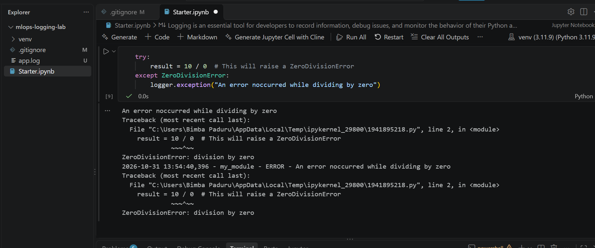
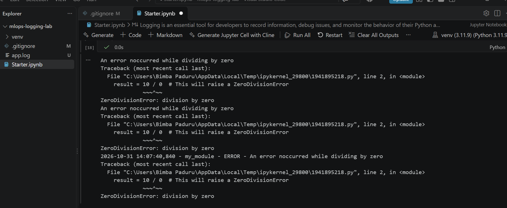
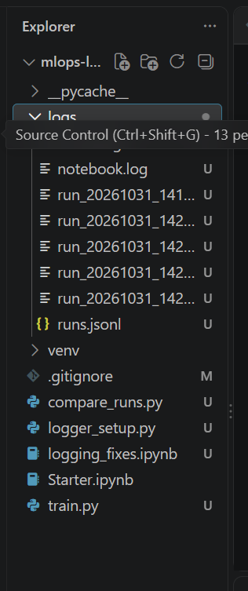

# Logging Lab: Fixing Logging Bugs and Logging ML Training Runs

This is my submission for the Logging lab from the course repo (Labs/Experiment_Tracking_Labs/Logging_Labs). The original lab is one notebook, Starter.ipynb, that shows the basics of the Python logging library: log levels, named loggers, logging exceptions, logging to a file and handlers.

When I ran the original notebook I found some problems in how logging was set up, so my work has two parts. First I fixed those problems and showed each one before and after. Then I built a reusable logger setup and used it to log machine learning training runs, since this lab is part of the experiment tracking topic.

## Problems I found in the original notebook

1. Logging to a file did not work. Section 6 calls `logging.basicConfig(filename='app.log', ...)`, but basicConfig only works the first time it is called. It was already called in section 2, so the second call is ignored and root logger messages never go to the file.
2. Messages were printed twice. Section 8 adds handlers to the `my_module` logger, but messages from that logger are also passed up to the root logger, which has its own handler. So every message showed up two times.
3. The new handlers had no formatter, so one of the two copies had no time, logger name or level.
4. Running the handler cell again added the same handlers again, so the messages repeated even more. When I ran it more than once the error showed up three times.
5. There is a typo in the last cell ("noccurred").

Original output with the duplicate message:



Output after running the handler cell more than once:



## What I changed

1. **logging_fixes.ipynb**: a short notebook that shows each bug and then the fix.
   1. Cell 1 shows the duplicate problem with a logger called bad_module.
   2. Cell 2 shows that a second basicConfig call is ignored. It prints `ignored.log was created: False`.
   3. Cell 3 fixes both problems by setting `propagate = False`, adding a formatter, and only adding a handler if the logger does not have one yet. Running this cell again still prints the message only once.
   4. Cells 4 and 5 use my logger setup and show that a debug message goes only to the file while info and error go to both the console and the file.
2. **logger_setup.py**: a `get_logger` function that can be reused in any script. It has three handlers with different levels:
   1. Console handler: shows INFO and above.
   2. Main log file: keeps everything including DEBUG. It uses a RotatingFileHandler so a new file is started after about 100 KB, keeping 3 old files.
   3. Error file (logs/errors.log): keeps only ERROR and above, so failures are easy to find.

   It also returns the same logger if it was already set up, so handlers are never added twice, and it sets `propagate = False` so nothing is printed twice.
3. **train.py**: trains a logistic regression model on the scikit-learn wine dataset and logs the whole run.
   1. Every run gets a run id (date and time) and its own log file in the logs folder.
   2. It logs the parameters, the data size (as DEBUG), the train and test row counts, training time and test accuracy.
   3. It logs a WARNING if accuracy is below 0.9.
   4. It uses `logging.captureWarnings(True)` so Python warnings, like the scikit-learn convergence warning, go into the same log format and log files instead of printing on their own.
   5. If something fails, it logs the full traceback with `logger.exception`, writes it to logs/errors.log as well, and exits with code 1.
   6. A summary of every successful run is added as one line to logs/runs.jsonl.
4. **compare_runs.py**: reads logs/runs.jsonl and prints all runs in a table sorted by accuracy, so different runs can be compared.
5. **requirements.txt**: the original lab did not have one. I added it with the exact package versions I used.

The original Starter.ipynb is kept unchanged in the repo so it can be compared with my changes.

## What you need to install

1. **Git**: download from https://git-scm.com and install with the default options.
2. **Python 3.11**: I used Python 3.11.9. Download it from https://www.python.org/downloads/ (look under "All releases" for 3.11.9). On Windows, tick "Add Python to PATH" on the first screen of the installer. I used 3.11 because some packages can have problems on the newest Python versions.
3. **VS Code** (to open the notebook): download from https://code.visualstudio.com and install the "Python" and "Jupyter" extensions from the Extensions tab. If you prefer Jupyter in the browser, you can run `pip install notebook` after step 3 below and then `jupyter notebook`.

## Setup

1. Clone the repo and go into the folder:

```
git clone https://github.com/bpaduru/mlops-logging-lab.git
cd mlops-logging-lab
```

2. Create and activate a virtual environment.

On Windows:

```
py -3.11 -m venv venv
venv\Scripts\activate
```

On Mac or Linux:

```
python3.11 -m venv venv
source venv/bin/activate
```

You should see `(venv)` at the start of the terminal line. If Windows PowerShell says running scripts is disabled, run `Set-ExecutionPolicy -Scope CurrentUser RemoteSigned`, type Y, and try again.

3. Install the packages:

```
python -m pip install --upgrade pip
pip install -r requirements.txt
```

The main packages are scikit-learn 1.9.1 (for the model and dataset) and ipykernel 7.4.0 (to run the notebook). The logging library is built into Python, so it does not need to be installed.

## How to run

### 1. Training runs

Run these one at a time from the main folder with the venv active:

```
python train.py
python train.py --C 0.01
python train.py --C 0.001
python train.py --max_iter 5
python train.py --test_size 1.5
python compare_runs.py
```

The options are `--C` (regularization strength, default 1.0), `--max_iter` (max training iterations, default 200) and `--test_size` (share of data used for testing, default 0.2).

### 2. Notebook

Open logging_fixes.ipynb in VS Code, click "Select Kernel" at the top right, choose the venv environment, then click "Run All".

## What a successful run looks like

The run ids and times will be different for you, but the accuracies should be the same because the data split uses a fixed random seed.

A normal run (`python train.py`):

```
INFO - starting run 20261031_141947
INFO - params: C=1.0, max_iter=200, test_size=0.2
INFO - train rows: 142, test rows: 36
INFO - training finished in 0.015 seconds
INFO - test accuracy: 0.9722
INFO - saved run summary to logs/runs.jsonl
```

With `--C 0.001` the accuracy drops to 0.8611 and the warning shows up:

```
WARNING - accuracy is below 0.9, check the params
```

With `--max_iter 5` the scikit-learn ConvergenceWarning is logged through my format by the `py.warnings` logger:

```
py.warnings - WARNING - ... ConvergenceWarning: lbfgs failed to converge after 5 iteration(s) ...
```

With `--test_size 1.5` the run fails on purpose. It logs an ERROR with the full traceback, and the same error is saved in logs/errors.log:

```
ERROR - run 20261031_142114 failed
Traceback (most recent call last):
...
InvalidParameterError: The 'test_size' parameter of train_test_split must be a float in the range (0.0, 1.0), an int in the range [1, inf) or None. Got 1.5 instead.
```

`python compare_runs.py` prints the successful runs sorted by accuracy:

```
run_id                   C  max_iter  accuracy    time
20261031_142040       0.01       200       1.0   0.031
20261031_142100        1.0         5       1.0   0.028
20261031_141947        1.0       200    0.9722   0.015
20261031_142051      0.001       200    0.8611   0.022
```

The failed run is not in this table because a summary is only saved when a run finishes.

After running everything, the logs folder has one run_*.log file per run, errors.log, notebook.log and runs.jsonl. The run log files also have DEBUG lines (like the number of rows and features loaded) that do not show in the terminal, because the console only shows INFO and above.



In the notebook, a successful run shows:

1. Cell 1: the message from bad_module printed more than once.
2. Cell 2: `ignored.log was created: False`.
3. Cell 3: `this message shows up once`, only one time, even if the cell is run again.
4. Cell 5: the contents of logs/notebook.log, including the line `debug goes only to the file`, which did not show in cell 4's output.

## Results and observations

1. Lowering C to 0.01 gave 1.0 accuracy, but going down to 0.001 made the model too simple and accuracy dropped to 0.8611, which triggered my warning.
2. With max_iter 5 the model did not finish training (convergence warning) but still got 1.0 accuracy on this small dataset. Without capturing warnings into the logs, this warning would only be printed once in the terminal and would be easy to miss.
3. The failed run shows why a separate error file is useful. The error and traceback are in logs/errors.log even though the terminal output is gone.

## Files in this repo

Starter.ipynb is the original lab notebook, unchanged.
logging_fixes.ipynb shows each bug from the original and the fix.
logger_setup.py has the reusable get_logger function.
train.py trains the model and logs the run.
compare_runs.py prints a comparison of all runs.
logs/ has the log files from my runs.
screenshots/ has the screenshots mentioned in README.
requirements.txt has the package versions I used.
